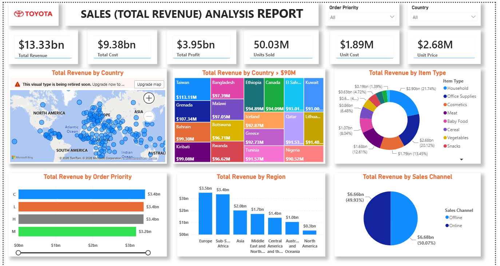

# Sales Revenue Analysis Dashboard (Power BI)

An interactive Power BI report that analyzes **$13.33bn in total revenue** across countries, regions, item types, sales channels and order priorities, with slicers for order priority and country.



[View the PDF version of the report](sales-revenue-dashboard.pdf)

## Overview

This dashboard answers a few core business questions:

- How much revenue, cost and profit does the business generate?
- Which item types, regions and countries drive revenue?
- How is revenue split between online and offline sales?
- Does order priority change how much revenue comes in?

## Key metrics

| Metric | Value |
|---|---|
| Total Revenue | $13.33bn |
| Total Cost | $9.38bn |
| Total Profit | $3.95bn |
| Units Sold | 50.03M |
| Unit Cost (summed) | $1.89M |
| Unit Price (summed) | $2.68M |

Profit margin works out to roughly 30% ($3.95bn of $13.33bn).

## Dashboard contents

- **KPI cards:** total revenue, total cost, total profit, units sold, unit cost and unit price.
- **Total Revenue by Country (map):** geographic spread of revenue.
- **Total Revenue by Country > $90M (treemap):** the countries with the highest revenue.
- **Total Revenue by Item Type (donut chart):** revenue share of each product group.
- **Total Revenue by Order Priority (bar chart):** revenue for each priority level.
- **Total Revenue by Region (column chart):** revenue for each world region.
- **Total Revenue by Sales Channel (pie chart):** online vs offline split.
- **Slicers:** Order Priority and Country.

## Key insights

- **Profit margin is about 30%.** Total profit is $3.95bn on $13.33bn in revenue.
- **Household and Office Supplies lead item types.** At $2.90bn (21.7%) and $2.68bn (20.1%), together they bring in about 42% of revenue. Cosmetics ($1.79bn) and Meat ($1.68bn) follow.
- **Europe and Sub-Saharan Africa are the top regions** at $3.5bn and $3.4bn. North America is the lowest at $0.3bn.
- **Online and offline sales are almost equal:** offline brings in $6.68bn (50.07%) and online $6.66bn (49.93%).
- **Order priority barely changes revenue.** Priorities C, L and H each bring in about $3.4bn, and M brings in $3.2bn.
- **Among countries above $90M, Taiwan is highest** at $113.11M, followed by Grenada ($107.34M) and Bahrain ($99.30M).

## Data and tools

- **Data source:** `[dataset name and link]`
- **Tools:** `[Power BI Desktop, Power Query, data modelling, DAX: keep only what you used]`
- **Key measures:**
  - **Total Revenue:** total sales revenue
  - **Total Cost:** total cost of the items sold
  - **Total Profit:** revenue minus cost
  - **Units Sold:** number of units sold
  - **Unit Cost:** summed unit cost
  - **Unit Price:** summed unit price

## Repository structure

```
├── sales-revenue-dashboard.pbix   # Power BI report file
├── sales-revenue-dashboard.pdf    # PDF export of the report
├── images/
│   └── dashboard-preview.png
└── README.md
```

## How to open

1. Download `sales-revenue-dashboard.pbix` from this repository.
2. Open it in [Power BI Desktop](https://powerbi.microsoft.com/desktop/) (free, Windows).
3. If prompted, update the data source path in **Transform data → Data source settings**.

Don't have Power BI? View the PDF export or the preview image above.

## Limitations and future work

- Figures come from the dataset used for this project and are not live business data.
- Unit cost and unit price are shown as sums, which are not very meaningful. Average unit cost and average unit price would be better.
- Order priority appears as codes (C, L, H, M) and could be expanded to readable labels.
- Planned improvements: add a monthly or yearly revenue trend, add a profit margin card, replace the donut chart with a sorted bar chart, and upgrade the map visual to Azure Maps.

## Author

**Olaogun Gabriel Olatunji**
CS graduate and Research Assistant, LAUTECH
[GitHub](https://github.com/GabrielDeAnalyst)
